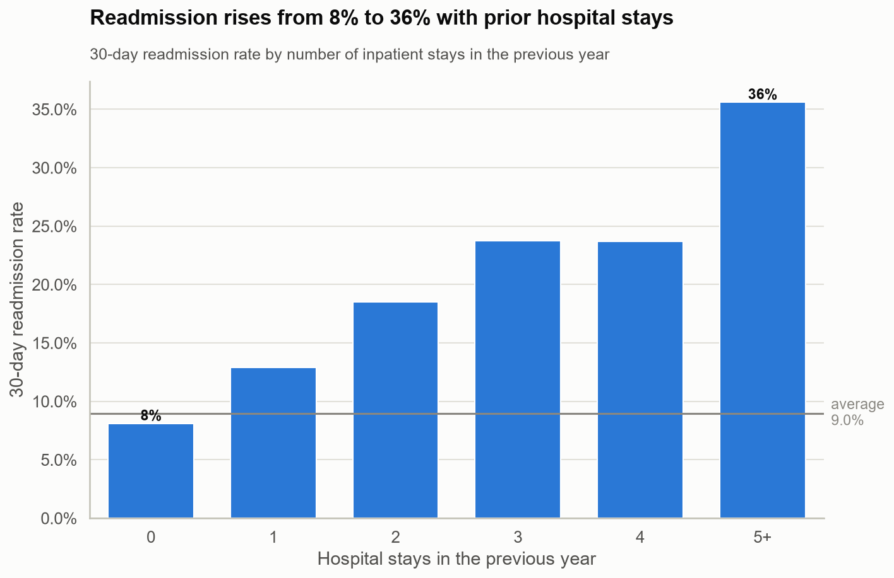
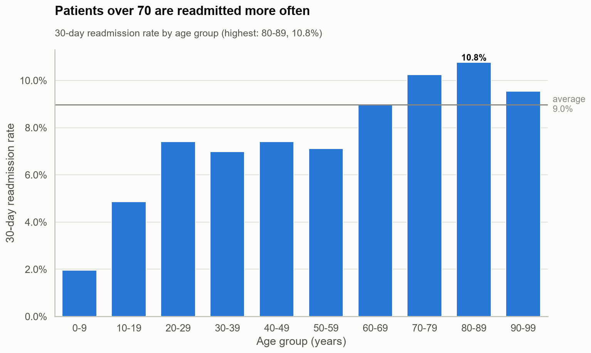
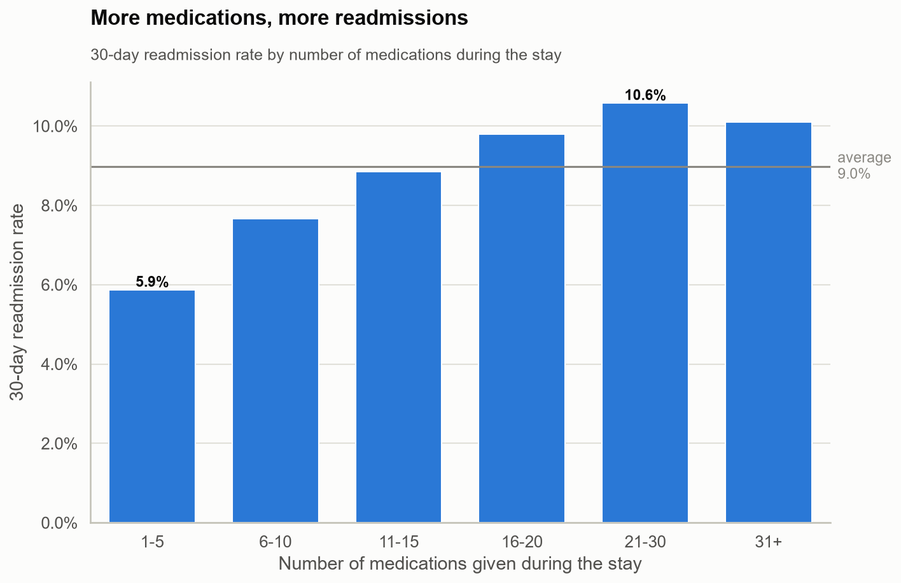
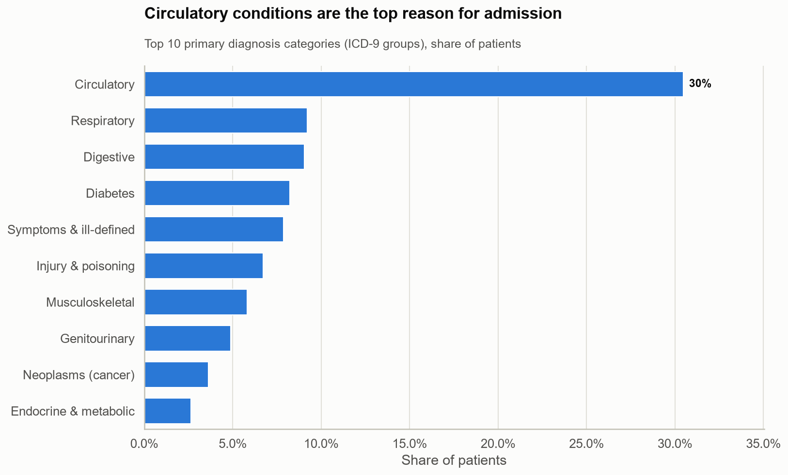
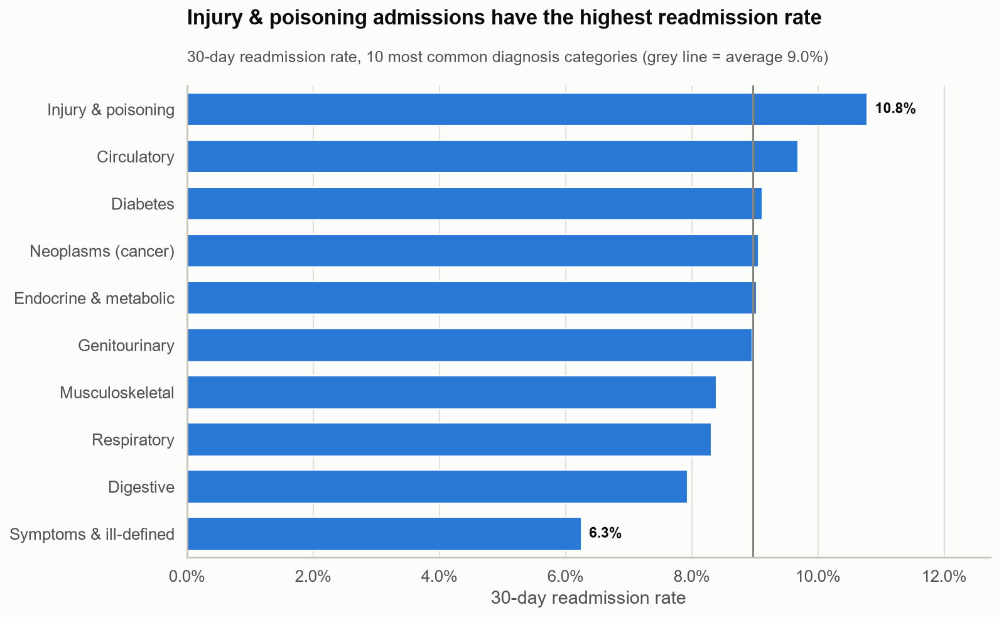
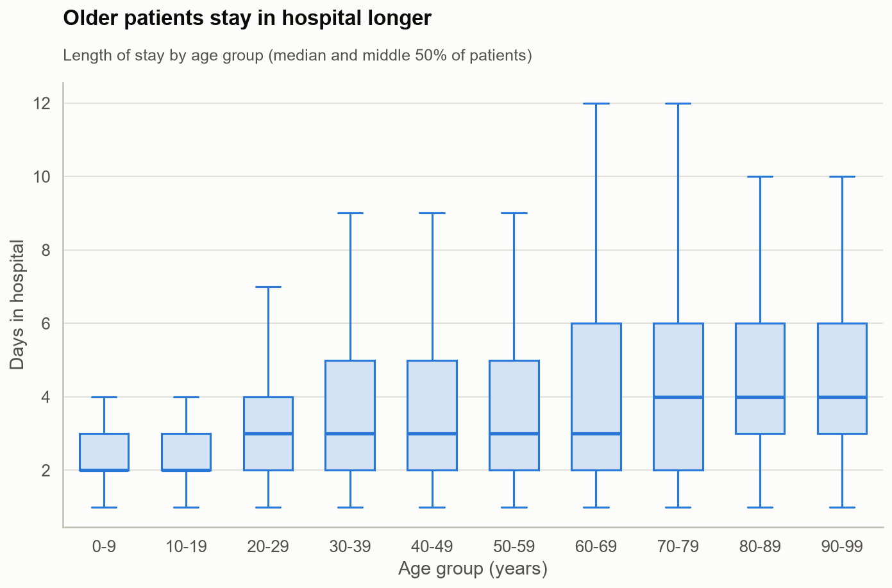
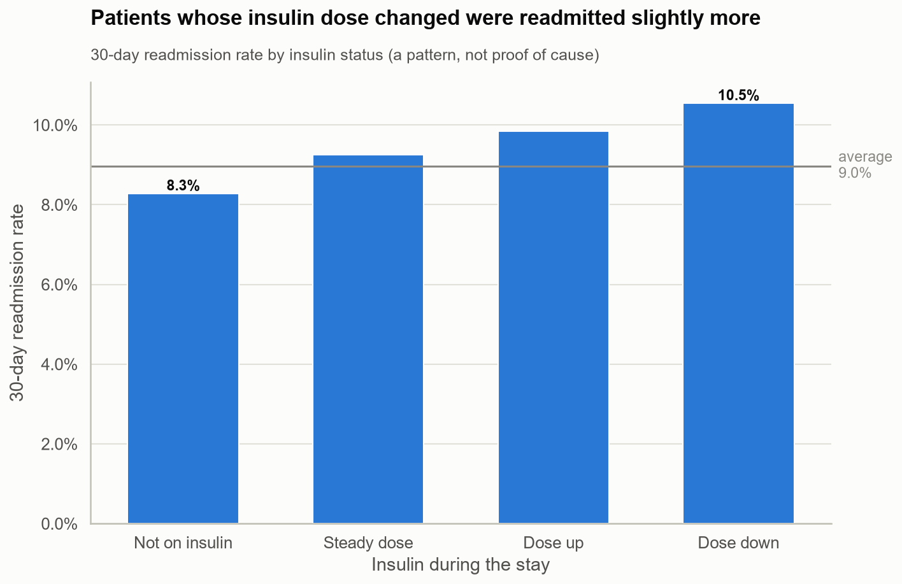
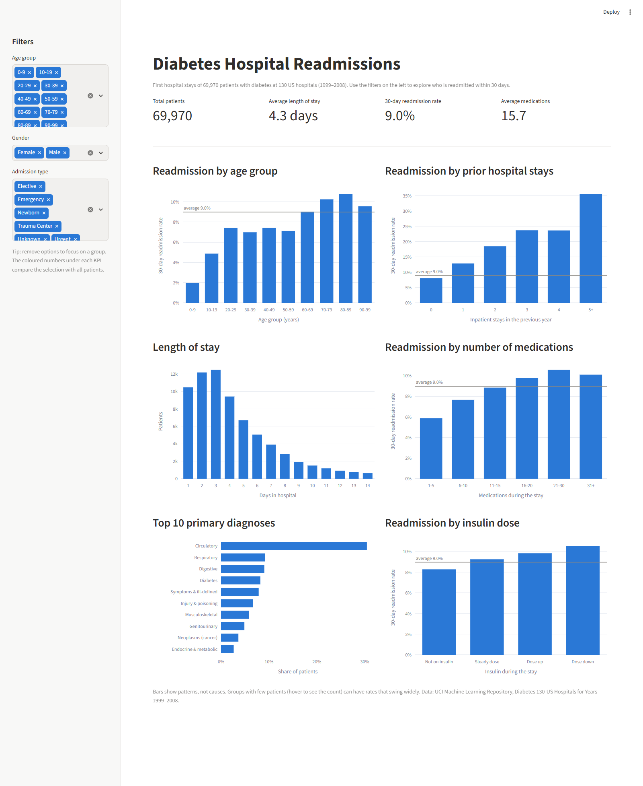

# Diabetes Hospital Readmissions: Healthcare Data Analysis

An analysis of 69,970 patients with diabetes across 130 US hospitals to find which patients are most likely to be readmitted within 30 days, with an interactive dashboard.

**Headline:** 9.0% of patients were readmitted within 30 days. Patients with more hospital stays in the previous year were readmitted far more often: 8.1% with none, 35.6% with five or more.

---

## 1. Dataset

| | |
|---|---|
| **Source** | [Diabetes 130-US Hospitals for Years 1999–2008](https://archive.ics.uci.edu/dataset/296/diabetes+130-us+hospitals+for+years+1999-2008), UCI Machine Learning Repository |
| **Original study** | Strack et al. (2014), *Impact of HbA1c Measurement on Hospital Readmission Rates*, BioMed Research International |
| **Size** | 101,766 rows × 50 columns (raw); 69,970 rows × 50 columns after cleaning |
| **One row means** | One hospital stay (an *encounter*) of a patient with diabetes. After cleaning, each row is a **different patient's first stay**. |
| **Target** | `readmitted`: back in hospital within 30 days (`<30`), after 30 days (`>30`), or not at all (`NO`) |

The columns cover demographics (age group, gender, race), the hospital stay (admission type, length of stay, lab tests, procedures), diagnoses (ICD-9 codes), 23 diabetes medications, and visits in the previous year.

## 2. Tools used

- **Python** with **pandas** and **NumPy** for cleaning and analysis
- **matplotlib** and **seaborn** for charts
- **Plotly** and **Streamlit** for the interactive dashboard
- **Jupyter** notebooks
- **ucimlrepo** to download the dataset
- **Power BI**: a step-by-step guide to rebuilding the dashboard ([POWERBI_STEPS.md](dashboard/POWERBI_STEPS.md))

## 3. Project structure

```
01-healthcare-data-analysis/
├── data/
│   ├── raw/                      # downloaded data (not in Git; recreated by data_loader.py)
│   └── processed/
│       └── cleaned_data.csv      # output of notebook 01
├── notebooks/
│   ├── 01_data_cleaning.ipynb    # cleaning, with the reason for every decision
│   ├── 02_eda.ipynb              # exploratory analysis of patient trends
│   └── 03_visualisations.ipynb   # 10 presentation-ready charts
├── src/
│   ├── data_loader.py            # downloads the dataset and ID mapping file
│   ├── icd9.py                   # groups ICD-9 diagnosis codes into categories
│   └── features.py               # shared analysis columns (used by notebooks and dashboard)
├── dashboard/
│   ├── app.py                    # Streamlit dashboard
│   └── POWERBI_STEPS.md          # how to rebuild the dashboard in Power BI
├── reports/
│   └── figures/                  # all charts as PNG
├── requirements.txt
└── README.md
```

## 4. Cleaning steps

Full reasoning for every step is in [01_data_cleaning.ipynb](notebooks/01_data_cleaning.ipynb).

- **Missing values:** in the original file these are stored as `"?"`, so they were converted to real missing values first.
- **Dropped `weight`** (97% missing) and **`payer_code`** (40% missing, and not related to the clinical question).
- **Kept the lab tests:** `max_glu_serum` and `A1Cresult` were filled with **"Not tested"**, because a gap there means the test wasn't done, which is itself information.
- **Labelled remaining gaps** in `medical_specialty`, `race` and the diagnosis codes as **"Unknown"** instead of guessing.
- **Removed 3 rows** with invalid gender, and **2 medication columns** that had the same value for every patient.
- **Kept one stay per patient** (their first), so patients with many visits are not counted many times. This removed 30,248 rows.
- **Removed 1,545 patients who died or went to hospice**, because they could not be readmitted.
- **Replaced ID codes with readable labels** (for example `1` → `Emergency`) using the official mapping file.
- **Added columns** `age_group`, `readmitted_30days` (Yes/No) and `length_of_stay`.

**Result:** 101,766 → 69,970 rows (68.8% kept), with no missing values.

## 5. Key findings

All numbers come from [02_eda.ipynb](notebooks/02_eda.ipynb). They are **patterns, not proof of cause** (see [Limitations](#7-limitations)).

**1. Prior hospital stays show the strongest pattern.** Readmission rises from **8.1%** for patients with no inpatient stay in the previous year to **35.6%** for those with five or more.



**2. Older patients are readmitted more often.** The rate is about **7%** for ages 20–59 and peaks at **10.8%** for ages 80–89.



**3. More medications go with more readmissions.** The rate is **5.9%** for patients given 1–5 medications and **10.6%** for 21–30.



**4. Circulatory conditions are the top reason for admission**, covering **30.5%** of patients, more than three times the next category (respiratory, 9.2%). Only **8.2%** were admitted mainly for diabetes itself.



**5. Readmission varies by diagnosis.** Among the 10 most common categories, it ranges from **6.3%** (symptoms & ill-defined conditions) to **10.8%** (injury & poisoning).



**6. Older patients stay longer.** The median stay is **3 days** overall. It is **2 days** for patients under 20 and **4 days** for patients aged 70 and over.



**7. Changing insulin goes with slightly more readmissions.** Patients whose insulin dose was lowered were readmitted **10.5%** of the time, compared with **8.3%** for patients not on insulin. The gap is small and may simply reflect that these patients were sicker.



**No single number strongly predicts readmission.** The largest correlation with readmission is prior inpatient stays, at only **0.10**. The strongest link between any two columns is length of stay with number of medications (0.47), as the [correlation heatmap](reports/figures/correlation_heatmap.png) shows.

## 6. Dashboard



The Streamlit dashboard shows:
- 4 KPI cards: patients, average stay, readmission rate and average medications
- 6 charts that update with filters for **age group**, **gender** and **admission type**

When a filter is on, each KPI card shows how the selected group compares with all patients. Hovering on a bar shows how many patients it is based on.

**Run it** from the repository root, after completing the setup in section 8:

```bash
.venv\Scripts\streamlit run 01-healthcare-data-analysis/dashboard/app.py     # Windows
.venv/bin/streamlit run 01-healthcare-data-analysis/dashboard/app.py         # macOS / Linux
```

It opens at http://localhost:8501.

## 7. Limitations

- **Old data:** the records are from **1999–2008**. Treatment, hospital practice and readmission policy have changed since, so the rates may not match hospitals today.
- **US hospitals only:** the 130 hospitals are in the United States, so the results may not apply to other health systems (for example the NHS).
- **Correlation, not causation:** every finding shows that two things happen together, not that one causes the other. For example, patients on many medications may simply be sicker.
- **One factor at a time:** each chart looks at a single factor. Factors overlap (older patients also take more medications), and a model that considers them together would be needed to separate their effects.
- **Missing information:** weight was almost never recorded, insurance was missing for 40% and the doctor's specialty for 49%, so those factors couldn't be studied.
- **Readmissions elsewhere:** a readmission to a hospital outside this database would not be recorded, so the true rate may be higher.
- **Dataset design:** the source only includes stays of 1–14 days. Keeping each patient's first stay assumes that a lower `encounter_id` means an earlier visit.
- **Old diagnosis codes:** diagnoses use ICD-9, which has since been replaced by ICD-10.

## 8. How to reproduce

You need Python 3.12 or newer (tested on 3.15) and Git. Commands are for Windows PowerShell; on macOS or Linux, use `source .venv/bin/activate` instead.

```bash
# 1. Get the code
git clone https://github.com/sanjanaverse/data-science.git
cd data-science

# 2. Create a virtual environment and install packages
python -m venv .venv
.venv\Scripts\activate
pip install -r 01-healthcare-data-analysis/requirements.txt

# 3. Register the environment as a Jupyter kernel
python -m ipykernel install --user --name healthcare-venv --display-name "Python (healthcare .venv)"

# 4. Download the raw data (about 19 MB, can take a few minutes)
python 01-healthcare-data-analysis/src/data_loader.py

# 5. Run the notebooks in order
cd 01-healthcare-data-analysis/notebooks
jupyter nbconvert --to notebook --execute --inplace 01_data_cleaning.ipynb
jupyter nbconvert --to notebook --execute --inplace 02_eda.ipynb
jupyter nbconvert --to notebook --execute --inplace 03_visualisations.ipynb
cd ../..

# 6. Start the dashboard
streamlit run 01-healthcare-data-analysis/dashboard/app.py
```

You can also open the notebooks in VS Code or Jupyter, choose the **"Python (healthcare .venv)"** kernel and select **Run All**.
