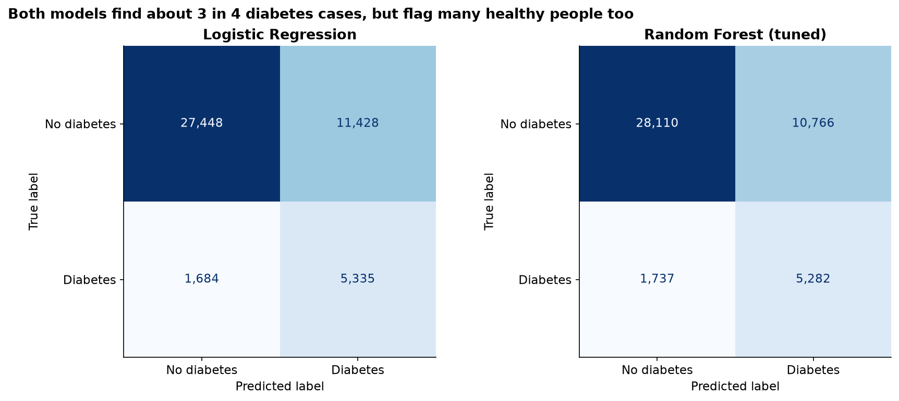
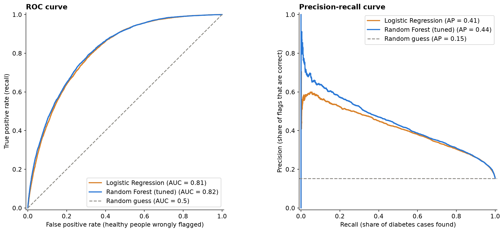
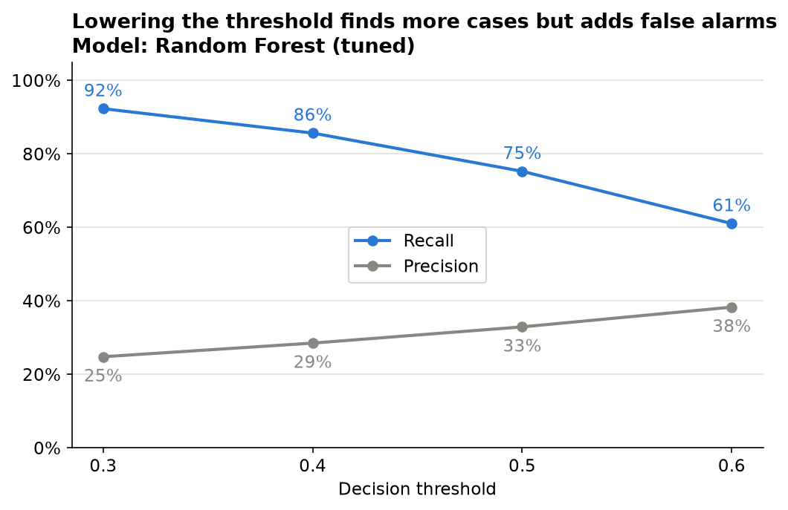
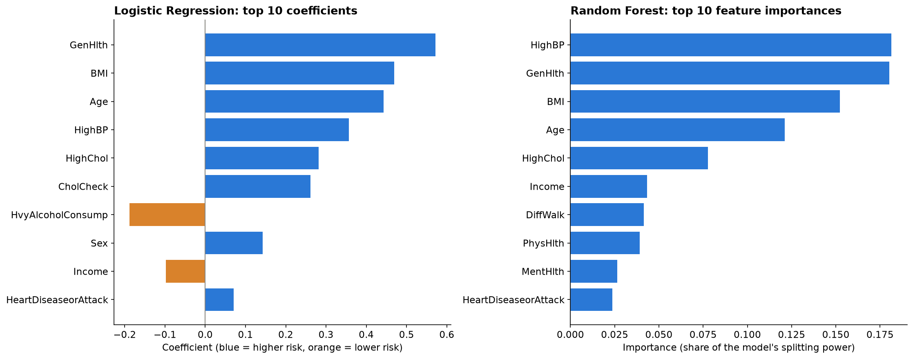

# Diabetes Risk Prediction

A machine learning model that estimates a person's risk of diabetes or prediabetes from 21 health-survey answers, to help decide who should be offered a blood test.

**Headline:** the best model (a tuned Random Forest) reaches a **ROC-AUC of 0.817** on unseen test data. At a screening threshold of 0.3, it finds **92% of people with diabetes or prediabetes**.

---

## 1. Problem statement

Many people with diabetes or prediabetes don't know they have it. A blood test can diagnose it, but testing everyone is expensive.

**Goal:** use simple survey answers (blood pressure, BMI, age, general health and similar) to **rank people by risk**, so that testing can be focused on those most likely to need it.

Because the aim is screening, **missing a person with diabetes is the costliest mistake**. This makes **recall** (the share of diabetes cases found) the most important measure, more important than overall accuracy.

## 2. Dataset

| | |
|---|---|
| **Source** | [CDC Diabetes Health Indicators](https://archive.ics.uci.edu/dataset/891/cdc+diabetes+health+indicators), UCI Machine Learning Repository, based on the CDC's 2015 Behavioral Risk Factor Surveillance System (BRFSS) telephone survey |
| **Size** | 253,680 rows × 23 columns (an ID, the target and 21 features) |
| **One row means** | One adult in the US who answered the survey |
| **Target** | `Diabetes_binary`: 0 = no diabetes, 1 = prediabetes or diabetes |
| **Features** | 21 survey answers: health conditions (high blood pressure, high cholesterol, heart disease, stroke), BMI, lifestyle (physical activity, smoking, diet, alcohol), self-rated health, age group, sex, education and income |
| **Class imbalance** | **13.9%** have diabetes or prediabetes and 86.1% don't. After removing duplicates: **15.3%** and 84.7%. |

There are no missing values. 24,206 rows (9.5%) are exact duplicates. They are kept for the EDA and removed before modelling (see section 3).

## 3. Approach

```
 Raw data (253,680 rows)
        │
        ▼
 01  EDA ─────────────── patterns, class imbalance, correlations
        │
        ▼
 02  Preprocessing ───── drop ID, remove 24,206 duplicates
        │                stratified 80/20 split (random_state=42)
        │
        ├──────────────────────────────┐
        ▼                              ▼
 Train set (183,579)           Test set (45,895)
        │                       (untouched until step 04)
        ▼                              │
 03  Training ────────── Pipeline: StandardScaler → model
        │                5-fold stratified cross-validation
        │                Logistic Regression vs Random Forest
        │                grid search for Random Forest (ROC-AUC)
        ▼                              │
 Saved models (.joblib)                │
        │                              │
        └──────────────┬───────────────┘
                       ▼
 04  Evaluation ──────── test-set scores, curves,
                         threshold analysis, feature importance
```

Key choices:
- **Duplicates removed before modelling.** Identical rows could otherwise land in both the train and the test set, which would make the test score look better than it really is.
- **Stratified split:** train and test both have exactly 15.29% diabetes cases.
- **The scaler sits inside the pipeline**, so it learns only from the training data. This prevents data leakage.
- **`class_weight="balanced"`** makes each diabetes case count 5.5 times as much as a non-diabetes case during training, so the models don't simply predict "no diabetes" for everyone.
- **The test set was used once**, in the final evaluation. Models were compared and tuned with cross-validation on the training set only.

## 4. Project structure

```
02-diabetes-risk-prediction/
├── data/
│   ├── raw/                          # downloaded data (not in Git; recreated by data_loader.py)
│   └── processed/                    # X_train, X_test, y_train, y_test (not in Git; recreated by notebook 02)
├── notebooks/
│   ├── 01_eda.ipynb                  # exploratory analysis
│   ├── 02_preprocessing.ipynb        # duplicates, train/test split, data leakage explained
│   ├── 03_model_training.ipynb       # cross-validation, grid search, saves the models
│   └── 04_evaluation.ipynb           # final test-set evaluation
├── src/
│   ├── data_loader.py                # downloads the dataset from UCI
│   ├── preprocessing.py              # split_data() and build_pipeline()
│   └── evaluate.py                   # metrics and plotting functions
├── models/                           # trained pipelines (.joblib, not in Git; recreated by notebook 03)
├── reports/
│   ├── model_comparison.csv          # cross-validation results
│   └── figures/                      # all charts as PNG
├── requirements.txt
└── README.md
```

## 5. Results

**Cross-validation on the training set** (5 folds, mean ± std):

| Model | Precision | Recall | F1 | ROC-AUC |
|---|---|---|---|---|
| Logistic Regression | 0.320 ± 0.001 | 0.754 ± 0.007 | 0.449 ± 0.001 | 0.807 ± 0.001 |
| Random Forest (default) | 0.392 ± 0.004 | 0.423 ± 0.005 | 0.407 ± 0.004 | 0.782 ± 0.001 |
| Random Forest (tuned) | 0.328 ± 0.002 | 0.743 ± 0.005 | 0.456 ± 0.002 | 0.812 ± 0.001 |

The default Random Forest overfit: its trees grew until they memorised the training data, and it found only 42% of diabetes cases. The grid search chose `n_estimators=200`, `max_depth=20` and `min_samples_leaf=10`.

**Final scores on the test set** (45,895 people, threshold 0.5):

| Model | Precision | Recall | F1 | ROC-AUC |
|---|---|---|---|---|
| Logistic Regression | 0.318 | **0.760** | 0.449 | 0.811 |
| **Random Forest (tuned)** | **0.329** | 0.753 | **0.458** | **0.817** |

The test scores closely match the cross-validation scores, so the models generalise well to unseen people.



At threshold 0.5, the Random Forest correctly flags 5,282 of the 7,019 people with diabetes and misses 1,737. It also flags 10,766 people who don't have diabetes.



**Choosing a threshold for screening (Random Forest, test set):**

| Threshold | Diabetes cases found (recall) | Cases missed | Share of flags that are correct (precision) |
|---|---|---|---|
| 0.5 (default) | 75.3% | 1,737 | 32.9% |
| 0.4 | 85.7% | 1,007 | 28.5% |
| **0.3** | **92.3%** | **541** | 24.8% |



**Chosen model:** the tuned Random Forest with a threshold of about 0.3. It finds 92% of cases, and the extra false alarms only lead to a routine follow-up blood test. Logistic Regression is a very close second (ROC-AUC 0.811). It trains in seconds and is easier to explain.

## 6. Key insights



- **Both models rely on the same top features:** general health, high blood pressure, BMI and age, followed by high cholesterol. In the Random Forest, these five account for about 71% of the total importance.
- **The same features show the clearest patterns in the raw data** ([01_eda.ipynb](notebooks/01_eda.ipynb)):
  - **Self-rated health:** 2.5% have diabetes among people rating their health "excellent", compared with 37.9% among those rating it "poor".
  - **BMI:** 5.7% at a healthy weight, compared with 33.5% at BMI 40 or more.
  - **Age:** 1.4% at ages 18–24, rising to 21.8% at ages 70–74.
  - **High blood pressure:** 24.4% with it, compared with 6.0% without.
- **Lower income and physical activity go with lower rates:** 8.0% for incomes of \$75k or more compared with 26.2% for \$10–15k, and 11.6% for active people compared with 21.1% for inactive people.
- **Some signals are probably effects, not risk factors.** For example, having had a cholesterol check (`CholCheck`) raises the predicted risk, probably because people already diagnosed with diabetes are monitored more often.

These are associations learned from the data, not causes.

## 7. Why this is NOT a medical diagnosis

This model produces a **risk score to suggest who should be tested**. It does not tell anyone whether they have diabetes. Only a blood test (such as HbA1c or fasting glucose), interpreted by a clinician, can diagnose diabetes.

- **Self-reported survey data:** every answer, including whether the person has diabetes, comes from a phone survey. People may misremember or misreport, and some people with diabetes don't know they have it.
- **Correlation, not causation:** the model learns which answers tend to appear together with diabetes. It can't say that any factor causes diabetes, or that changing it would lower someone's risk.
- **Population bias:** the data covers US adults in 2015 who answered a telephone survey. The model may perform differently in other countries, in other years, or for groups who are under-represented in phone surveys.
- **No clinical validation:** the model has only been tested on held-out survey data, never in a real clinic or against confirmed diagnoses.
- **False negatives still happen:** even at threshold 0.3, the model misses 541 of the 7,019 diabetes cases in the test set (7.7%). A low score must never be read as "you don't have diabetes".

## 8. Limitations and next steps

**Limitations**
- The target combines **prediabetes and diabetes**, so the model can't tell them apart.
- **Precision is low** (about 1 in 3 flags is correct at 0.5, and 1 in 4 at 0.3). Many healthy people would be sent for testing.
- Some features (self-rated health, `CholCheck`, difficulty walking) may be partly **a result of a diabetes diagnosis**, which can make the model look better than it would be for undiagnosed people.
- The threshold trade-off was **shown on the test set**. A production model should choose its threshold with cross-validation on the training data.
- Random Forest feature importance can favour features with many values (like BMI), so it is only a rough ranking.

**Next steps**
- Choose the threshold with cross-validation, then confirm it on the test set.
- Try gradient boosting (for example `HistGradientBoostingClassifier`), which often does better on tabular data.
- Use permutation importance or SHAP values for more reliable explanations.
- Retrain without the features that may be consequences of diagnosis, and compare the scores.
- Check the probabilities are well calibrated, so that a score of 0.3 really means about 30% risk.
- Test the model on a more recent BRFSS year.
- Use 100 trees instead of 200: the cross-validated ROC-AUC was identical, with half the model size.

## 9. How to reproduce

You need Python 3.12 or newer (tested on 3.15) and Git. Commands are for Windows; on macOS or Linux, use `source .venv/bin/activate` instead.

```bash
# 1. Get the code
git clone https://github.com/sanjanaverse/data-science.git
cd data-science

# 2. Create a virtual environment and install packages
python -m venv .venv
.venv\Scripts\activate
pip install -r 02-diabetes-risk-prediction/requirements.txt

# 3. Register the environment as a Jupyter kernel
python -m ipykernel install --user --name healthcare-venv --display-name "Python (healthcare .venv)"

# 4. Download the raw data (about 13 MB)
python 02-diabetes-risk-prediction/src/data_loader.py

# 5. Run the notebooks in order
cd 02-diabetes-risk-prediction/notebooks
jupyter nbconvert --to notebook --execute --inplace 01_eda.ipynb
jupyter nbconvert --to notebook --execute --inplace 02_preprocessing.ipynb
jupyter nbconvert --to notebook --execute --inplace --ExecutePreprocessor.timeout=1800 03_model_training.ipynb
jupyter nbconvert --to notebook --execute --inplace 04_evaluation.ipynb
```

**Run order matters:** notebook 02 creates the train/test files, 03 trains and saves the models, and 04 loads both. Notebook 03 takes about 6 minutes on an 8-core laptop (mostly the grid search).

You can also open the notebooks in VS Code or Jupyter, choose the **"Python (healthcare .venv)"** kernel and select **Run All**.
